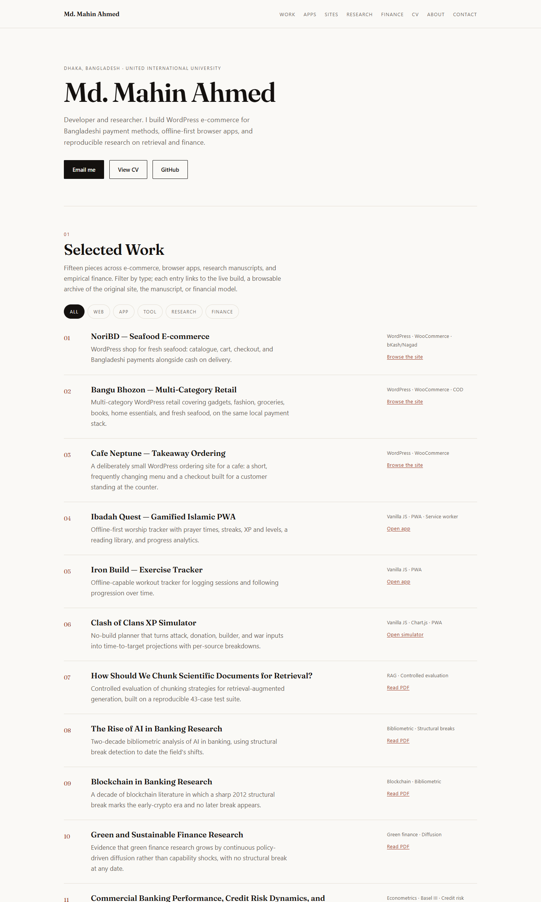
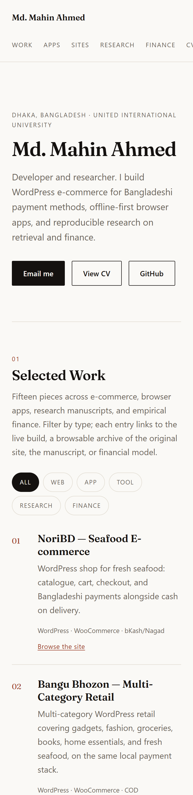

# Portfolio

[](https://ahnafmohsieu.github.io/Portfolio/) [](LICENSE)

> ← [All projects](https://ahnafmohsieu.github.io/Portfolio/hub/)

Single-page portfolio for Md. Mahin Ahmed — WordPress e-commerce builds,
offline-first browser apps, and research manuscripts.

<p align="center">
  <a href="https://ahnafmohsieu.github.io/Portfolio/">
    
  </a>
</p>

<details>
  <summary>Mobile view</summary>
  <p align="center">
    
  </p>
</details>

Live site: https://ahnafmohsieu.github.io/Portfolio/

## Curriculum Vitae

Two editions — general and banking — live in `cv/`, next to a small viewer at
`cv/index.html` that tabs between them and links to the raw PDFs. No build step.
The CV is part of this repository rather than a separate project.

## Project hub

The account-root landing page is preserved in `hub/` (`index.html` and
`styles.css`), served at `/Portfolio/hub/`. The former profile README text is
kept in `docs/profile-readme.md`. Both are plain static files.

## Editing

Everything a visitor reads lives in `index.html`, written by hand. To change a
work entry, edit its `<li class="work__row">` block; `data-cat` must stay one of
`web`, `app`, `tool`, `research`. To add a paper, copy the PDF into
`assets/papers/` and add a matching `<article class="paper">` block.

Design tokens (colors, fonts, widths) are the custom properties at the top of
`styles.css`. No build step, no dependencies.

## Tests

```bash
node --test tests/site.test.js
```

The suite checks page structure, that no inline handlers crept in, that the copy
never calls a manuscript "published", and that every local link and asset exists
on disk.

## Deployment

Served by GitHub Pages from `main` / `/ (root)`. Pushing to `main` republishes
the site; no build step runs.

## Known limitations

- The three WordPress storefronts are published as static archives under
  [Websites](https://ahnafmohsieu.github.io/Websites/), captured from the
  running installs. Every page, product, and image is browsable; cart and
  checkout cannot work because static hosting cannot run PHP or MySQL.
- The four papers are manuscripts prepared for submission, not published work.


## License

All rights reserved. See [LICENSE](LICENSE). The code and content are published
for viewing and evaluation only.
